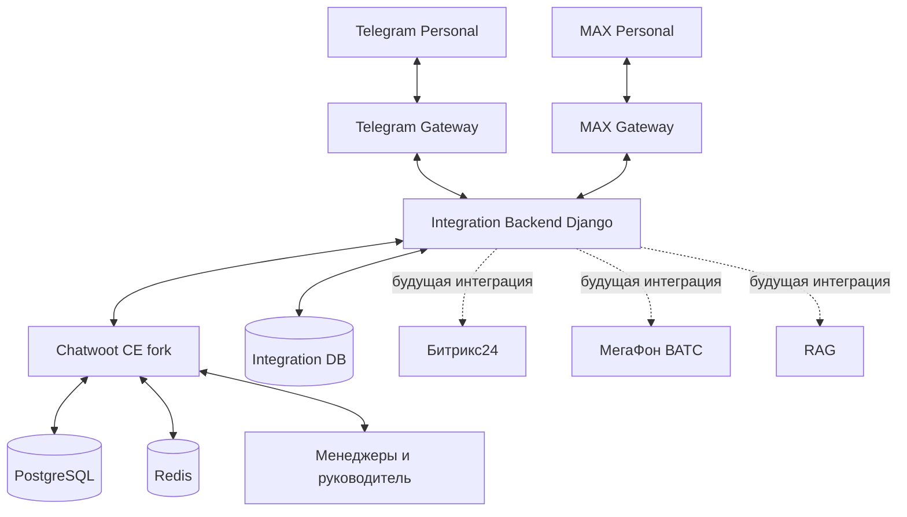

# ТЗ для Codex: корпоративный мультимессенджер на Chatwoot Community Edition

## 1. Цель проекта
Создать self-hosted аналог Pact для отдела продаж юридической компании. Менеджеры работают в самостоятельном веб-интерфейсе Chatwoot, каждый под своей учетной записью. Компания использует один общий личный аккаунт Telegram и один общий личный аккаунт MAX. Менеджер видит исключительно закрепленных за ним клиентов и их переписки. Руководитель видит все диалоги и управляет назначениями. В дальнейшем подключаем Битрикс24, МегаФон ВАТС и ИИ-помощника; они не входят в MVP.

Не покупать Enterprise и не обходить проверки лицензии: реализовать собственную политику доступа поверх открытого кода CE, соблюдая лицензии всех зависимостей. Не копировать закрытые Enterprise-компоненты.

## 2. Инструкции Codex
- Сначала изучи репозиторий и существующие файлы. Если он пуст, подготовь воспроизводимый bootstrap официального Chatwoot CE с закрепленным стабильным тегом и commit SHA. Не выдумывай существующие классы, маршруты и API: проверь исходники выбранной версии.
- До изменений составь `docs/discovery.md`: версия, лицензии, текущие политики доступа, API, WebSocket, фоновые задачи, возможности API inbox, ограничения MAX и Telegram. Отдельно перечисли неизвестные и блокирующие вопросы.
- Работай небольшими проверяемыми этапами, добавляй тесты и миграции. Не переписывай весь Chatwoot. Сохраняй совместимость с upstream, документируй измененные файлы и причины.
- Не используй реальные клиентские данные, производственные токены или аккаунты для разработки. Не коммить секреты. Не заявляй, что интеграция работает, пока нет воспроизводимого теста.
- В первой итерации выполни только этап 0 и подготовь план этапа 1; после отчета переход к следующему этапу согласуется с владельцем проекта.

## 3. Границы MVP
Включено: авторизация, роли, два общих канала, создание исходящего диалога по номеру телефона (если разрешено платформой), прием и отправка текста и вложений, закрепление клиента, очередь неназначенных, передача клиента, история, уведомления, аудит, Docker Compose, резервное копирование.
Не включено: Битрикс24, телефония, RAG, мобильная разработка, массовые рассылки, автоматические продажи, биллинг, мультиарендность как продукт. Не обходить антиспам, приватность или ограничения мессенджеров.

## 4. Архитектура

Chatwoot (Rails/Vue, проверить версию) — источник истины по клиентам, назначениям и доступу. Django/DRF — адаптеры, маршрутизация, надежная доставка и будущая CRM-интеграция. Не дублировать авторизацию менеджеров в Django; запросы от UI идут через Chatwoot, сервисные вызовы аутентифицируются отдельно. PostgreSQL может быть одним экземпляром с отдельными БД и ролями. Redis для очередей; Sidekiq для Chatwoot, Celery для Django при необходимости. Вложения — приватное объектное хранилище или защищенный volume. Nginx/Caddy — HTTPS reverse proxy. Gateways не доступны из интернета напрямую.

Предпочтительная структура: `chatwoot/` (fork), `integration/`, `gateways/telegram/`, `gateways/max/`, `infra/`, `docs/`, `tests/e2e/`, `compose.yaml`, `.env.example`, `README.md`. Адаптировать под реальный репозиторий.

## 5. Роли и строгая изоляция
| Операция | Менеджер | Руководитель | Технический администратор |
|---|---|---|---|
| Свои клиенты и чаты | Да | Все | По отдельному разрешению |
| Чужие клиенты и чаты | Нет | Да | По отдельному разрешению |
| Неназначенные входящие | Нет | Да | По отдельному разрешению |
| Начать чат со свободным клиентом | Да | Да | Нет по умолчанию |
| Передать/освободить клиента | Нет | Да | Нет по умолчанию |
| Управлять каналами и секретами | Нет | Нет | Да |

Политика deny-by-default. Все операции проверяют account_id и ownership на сервере. Сервисная учетная запись имеет минимально необходимые права. Не выдавать менеджерам административные токены или сессии мессенджеров.

Доработать CE собственными scopes/policies и UI. Проверить ВСЕ поверхности: списки, карточки контактов, поиск, прямые URL и API ID, сообщения, создание/изменение/удаление, экспорт, отчеты, счетчики, уведомления, WebSocket/ActionCable, вложения и превью, подписанные ссылки, фоновые задачи, API токены, мобильные API, bulk actions, упоминания, команды, заметки, автоматизации. Не полагаться на фильтрацию Vue. Не отдавать чужие данные даже скрытыми в JSON. При передаче клиента прекратить новые события старому владельцу, обновить подписки и UI; ранее скачанные данные технически отозвать невозможно. Приватные файлы отдавать после проверки прав, избегать долгоживущих публичных URL. Не раскрывать имя чужого клиента или ответственного через поиск/ошибки. Технический администратор инфраструктуры физически может иметь доступ к БД — это отдельная доверенная роль.

## 6. Модель данных и закрепление
Использовать существующие Contact, Conversation, Inbox, Message и User там, где возможно. Добавить собственную модель ownership или поля после анализа схемы. Концептуально:
- CustomerOwnership: account_id, contact_id, owner_id, assigned_at, version; уникальность account_id+contact_id.
- ChannelIdentity: account_id, contact_id, channel, external_account_id, external_user_id, verified_phone (nullable); уникальность по каналу, внешнему аккаунту и внешнему ID.
- AssignmentAudit: actor, old_owner, new_owner, reason, timestamp, correlation_id.
- DeliveryRecord / InboxEvent / OutboxEvent в integration DB: внешний ID, ключ идемпотентности, статус, попытки, ошибка, timestamps.

Номер нормализуется в E.164. Не считать совпадение имени или username доказательством идентичности. Сопоставление Telegram и MAX по достоверному номеру либо подтвержденное руководителем объединение; при конфликте — ручное разрешение. Не раскрывать чужие контакты при поиске. Один клиент может иметь несколько каналов, но одного владельца. Conversation.assignee синхронизируется с владельцем клиента; закрытие чата не снимает владение. Не разрешать штатным автоматизациям менять владельца в обход общей политики.

### Исходящий диалог
1. Менеджер вводит номер и выбирает канал.
2. Backend проверяет права и нормализует номер; gateway выполняет разрешенный платформой поиск адресата.
3. В транзакции Chatwoot проверяет/создает идентичность и атомарно резервирует владельца (unique constraint + row lock/конфликт). При двух одновременных запросах выигрывает один; второй получает нейтральный отказ без чужих данных.
4. Создается или переиспользуется диалог. Отправка только после фиксации владения. Сбой отправки виден сотруднику, повтор не создает второй чат. Не освобождать клиента автоматически при неоднозначном результате доставки; руководитель решает конфликт.
5. Входящие сообщения направляются владельцу. Если адресат не найден или приватность запрещает контакт, показать понятную ошибку без обхода ограничений.

### Входящий диалог
Gateway получает событие, сохраняет его надежно, определяет внешнюю идентичность, создает/обновляет контакт и сообщение. Известный клиент направляется владельцу; неизвестный попадает в очередь руководителя. Руководитель назначает сотрудника. До назначения менеджеры не видят чат. Не назначать случайному сотруднику в MVP.

### Передача
Руководитель передает клиента целиком со всеми каналами и историей. Транзакция меняет ownership и assignee, пишет аудит, публикует событие. Проверить конкурентную отправку во время передачи: повторная проверка версии назначения перед постановкой/отправкой, отмена еще не отправленных сообщений старого владельца; уже отправленные сообщения не отзываются. При увольнении отключить учетную запись, отозвать токены и передать клиентов.

## 7. Коннекторы
Единый интерфейс адаптера (псевдоконтракт, не утверждение о существующих API): `connect`, `health`, `resolve_recipient`, `send_message`, `receive_events`, `download_attachment`, `reconcile`. Единый формат события: channel, external_account_id, external_chat_id, external_message_id, sender_id, direction, timestamp, text, attachments, reply_to, event_type, correlation_id. Не логировать тело сообщений по умолчанию.

### Telegram Personal
Использовать документированный MTProto через Telethon или TDLib после оценки лицензий и совместимости. Не Bot API. Один постоянный процесс на сессию, защищенное хранение session, авторизация с 2FA администратором, восстановление после рестарта. Проверить разрешенный поиск по номеру, исходящие сообщения, входящие, фото, документы, голосовые, ограничения FloodWait и приватности. Не обходить лимиты; учитывать сообщения, отправленные из официального клиента, предотвращать эхо.

### MAX Personal — блокирующий технический эксперимент
Наличие стабильного официального API личных аккаунтов не предполагается. Изучить актуальную документацию, условия использования и существующие открытые реализации (например, Telemax — сначала проверить репозиторий, лицензию и актуальность). Не использовать неподтвержденные методы в production. Не обходить защиту, антиспам или ограничения доступа. Если разрешенный и надежный способ отсутствует, остановить MAX-часть и предложить официальный/договорной API провайдера либо согласовать изменение требований. Бот не считается эквивалентом личного аккаунта.

Критерии PoC на тестовом аккаунте: авторизация, восстановление сессии, получение входящего, отправка ответа, начало диалога по номеру при разрешении платформы, вложения, отсутствие дублей после рестарта, обработка отключения, документированные риски и условия использования. Зафиксировать реальные результаты и ограничения в `docs/max-poc.md`. Не обещать нулевую стоимость MAX до завершения PoC.

## 8. Доставка сообщений
Использовать API inbox и webhooks Chatwoot после проверки контрактов выбранной версии. Входящие и исходящие события различать по direction/origin; не отправлять обратно входящие сообщения и внутренние заметки. Сохранять событие до подтверждения приема. Идемпотентность по каналу/аккаунту/внешнему ID и ключу исходящей операции. Очереди, retry с backoff, dead-letter, ручной повтор и reconciliation. Не обещать exactly-once для внешних API: при таймауте с неизвестным исходом сначала сверять состояние, не повторять слепо. Сохранять порядок в пределах диалога где возможно. Статусы pending/sent/failed/unknown, delivered/read только если реально поддерживаются платформой. Webhooks аутентифицировать, проверять replay, ограничивать размер запросов. Вложения проверять по размеру и типу, сканировать, не выполнять содержимое.

## 9. UX
Оставить привычный интерфейс Chatwoot. Менеджер: «Мои клиенты», «Мои диалоги», поиск только своих клиентов, кнопка «Новый диалог» с номером и каналом, индикатор доставки и ошибки, уведомления только по своим чатам. Руководитель: все клиенты, очередь неназначенных, фильтр по сотруднику/каналу, передача клиента, журнал назначений. Убрать недоступные действия из UI, сохранив серверные проверки. Русский интерфейс. Не требовать открытия Битрикса для общения.

## 10. Инфраструктура и безопасность
Docker Compose: reverse proxy, chatwoot-web, chatwoot-worker, postgres, redis, integration-web, integration-worker, telegram-gateway, max-gateway (после PoC), при необходимости object storage. Закрепить версии, healthchecks, restart policies, persistent volumes, миграции и инструкции обновления/отката. `.env.example` без секретов. TLS, закрытая внутренняя сеть, минимальные DB grants, защищенные сессии, ротация ключей, ограничение доступа к админке, MFA где доступно. Не хранить реальные данные в dev/staging. Резервные копии БД, вложений и защищенных сессий; тест восстановления. Метрики: очередь, ошибки, reconnect, задержка доставки, место на диске; без текста переписок в логах.

Для юридической компании согласовать размещение и обработку персональных данных, требования 152-ФЗ и локализации, сроки хранения, основания обработки, доступ сотрудников и передачу данных провайдерам. Для production использовать согласованную инфраструктуру; не отправлять документы в сторонние ИИ-сервисы в MVP. Это требования к проверке, а не утверждение о юридическом соответствии.

## 11. Будущая интеграция с Битрикс24
В MVP заложить стабильные UUID/ID клиента, владельца, диалога и события `customer.assigned`, `customer.transferred`, `message.received`, `message.sent`. Версионировать контракт. В дальнейшем добавить mapping Bitrix user/contact/deal IDs, поиск по нормализованному номеру, запись коммуникаций в таймлайн, ссылку на чат, синхронизацию ответственного. Перед реализацией выбрать источник истины по назначениям (предпочтительно CRM после интеграции), правила конфликтов и предотвращение циклов. Смена ответственного в CRM должна проходить через ту же политику передачи клиента. Не реализовывать сейчас. МегаФон ВАТС и RAG — отдельные адаптеры в следующих версиях.

## 12. Тестирование и критерии приемки
Использовать минимум двух менеджеров A/B, руководителя R, тестовые аккаунты обоих каналов и mock gateways для CI.
- A начинает чат с X; X закреплен за A; B не может начать второй чат с X или получить его данные.
- Одновременная попытка A/B закрепить X дает ровно одного владельца.
- B не видит X в списках, поиске, контактах, счетчиках, уведомлениях, WebSocket, экспорте и не получает сообщения/файлы по прямым ID; проверить все HTTP методы и токены.
- A не видит клиентов B. R видит всех и может передать X от A к B; A теряет доступ, B получает историю обоих каналов.
- Закрытие/повторное открытие чата сохраняет владельца. Неизвестный входящий виден только R до назначения.
- Сопоставление подтвержденной идентичности между каналами сохраняет одного владельца; конфликт требует ручного решения.
- Текст и согласованные вложения отправляются/принимаются в обоих каналах; ограничения платформы явно отображаются.
- Дубликаты webhook, сбой сети, рестарт gateway/worker и таймаут отправки не приводят к потере сохраненных событий или слепой повторной отправке.
- Внутренние заметки не уходят клиентам. Отозванные токены не работают. Проверить межаккаунтную изоляцию.
- Backup/restore проверен; README позволяет развернуть чистую установку. MAX PoC успешно пройден либо MVP явно отмечен как неполный.

Тесты: Rails policy/request/channel specs, Vue component tests, Django unit/integration tests, E2E Playwright, ручной smoke test реальных тестовых каналов. CI не зависит от живых мессенджеров. Не считать скрытие вкладки доказательством изоляции.

## 13. Этапы реализации
0. Discovery: изучить CE и лицензии, выбрать версию, составить карту поверхностей доступа и план PoC MAX. Результат: docs/discovery.md, список рисков и решений, план изменений.
1. Развернуть чистый CE через Docker, создать A/B/R, воспроизвести исходные права, провести MAX PoC до больших затрат на разработку. Результат: compose, README, docs/max-poc.md. Go/no-go по MAX.
2. Реализовать ownership, миграции, серверные политики, аудит, UI и тесты изоляции на mock inbox. Не подключать реальные данные до прохождения security-тестов.
3. Реализовать Django integration backend, контракт адаптеров, надежную доставку и Telegram gateway.
4. Реализовать MAX gateway только после успешного PoC; подключить оба канала, создание исходящих чатов, вложения, обработку сбоев.
5. E2E, нагрузочный тест с согласованным числом менеджеров, security review, backup/restore, пилот на тестовых клиентах. Исправить блокирующие дефекты.
6. Production после согласования безопасности и условий платформ. Битрикс24 — отдельное ТЗ после стабильного MVP.

## 14. Definition of Done и отчет Codex
Для каждого этапа: перечислить измененные файлы, команды запуска, миграции, выполненные тесты с фактическими результатами, известные ограничения, открытые вопросы, следующий шаг. Поддерживать `docs/architecture.md`, `docs/security.md`, `docs/operations.md`, `docs/decisions/`. Не скрывать проваленные тесты. Не запускать production, не подключать реальные аккаунты и не выполнять необратимые действия без согласования.

Первое задание: выполнить этап 0. Особое внимание — строгая изоляция на CE и осуществимость MAX Personal. Если репозиторий пуст, подготовить план bootstrap; если исходники уже есть, проанализировать их. Не начинать переписывать интерфейс до проверки серверной модели доступа.
