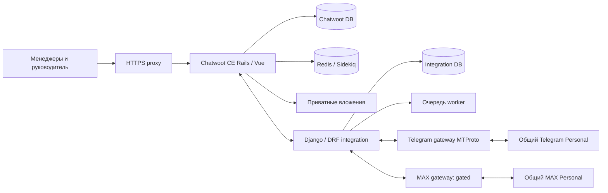

# Целевая архитектура (проект, этап 0)

Актуальное состояние реализации и фактических проверок: [current-status.md](current-status.md). MAX отложен, активный канал — Telegram Personal.
Основание: [discovery](discovery.md). Компоненты ниже ещё не реализованы.

## Границы ответственности

Chatwoot — источник истины для контакта, владельца, доступов и истории. UI вызывает только Chatwoot; Django не содержит отдельную авторизацию менеджеров. Django хранит mapping доставки, durable inbox/outbox, retry/reconciliation, не принимает решение о владельце. Одна PostgreSQL-инсталляция допустима, но отдельные БД, роли и grants для CW/integration; gateway не получает доступ к БД Chatwoot. Redis/очереди разделяются по сервисам и ключам, не используются как единственный журнал событий.

Gateways доступны только во внутренней сети, один постоянный активный процесс на внешнюю сессию. Секреты и session volume не выдаются UI или Django без необходимости. Reverse proxy открывает только нужные маршруты Chatwoot; integration и gateway health/auth endpoints не публикуются. Нужен отдельный аутентифицированный ingress webhook между CW и integration.

## Предлагаемые собственные сущности

| Сущность | Где | Инварианты |
|---|---|---|
| BusinessRoleMembership | CW DB | Уникальность account/user; manager, supervisor, technical_admin; отсутствие записи означает deny |
| CustomerOwnership | CW DB | unique(account_id, contact_id), owner nullable для очереди; version, assigned_at; owner — активный участник того же account |
| ChannelIdentity | CW DB | unique(account_id, channel, external_account_id, external_user_id); contact из того же account; verified_phone nullable, provenance верификации |
| AssignmentAudit | CW DB | actor/тип actor, старый/новый owner, причина, время, correlation_id, версия; неизменяемость через application permissions |
| IntegrationOutboxEvent | CW DB | Транзакционно вместе с изменением CW; immutable event_id, schema_version, assignment_version, минимальный payload, ACK state |
| InboxEvent / OutboxEvent / DeliveryRecord | Integration DB | Unique внешний ключ и operation UUID; attempt, pending/sent/failed/unknown, external IDs, ошибка без тела переписки |

Имена проектные, не утверждение о наличии upstream классов. Schema migrations только в этапе 2/3. Ownership не хранить в свободно редактируемых custom_attributes. Один Contact объединяет каналы только при проверенной идентичности или audited решении руководителя. E.164 — формат, не доказательство принадлежности номера; имя/username не используются как автоматическое основание слияния.

## Закрепление и исходящая отправка

1. CW проверяет бизнес-роль, нормализует номер; resolve через gateway допускается только для авторизованного действия, с rate limit. Уже известный чужой номер не раскрывает данные.
2. В транзакции CW находит/создаёт ChannelIdentity, Contact, ownership. При отсутствии строки row lock недостаточен: нужны unique constraint и обработка concurrent insert. Один контакт по подтверждённому телефону между каналами требует сериализации ключа идентичности, а не только блокировки contact_id.
3. После конфликта повторно читает зафиксированную запись: только один менеджер становится владельцем; проигравший получает нейтральный отказ. Не создавать второй контакт при гонке identity и не посылать до commit.
4. Создаёт/переиспользует Conversation и Message, синхронизирует assignee, сохраняет operation UUID и CW outbox в одной транзакции. Worker доставляет событие в integration, затем gateway.
5. Перед каждой фактической отправкой проверяется актуальная версия назначения. Повторная операция не создаёт сообщение или диалог повторно. После таймаута unknown — сначала reconcile, без слепого повтора.

## Входящие, передача и гонка с отправкой

Gateway сначала durable сохраняет событие/курсор, затем подтверждает внутренний приём. Внешний протокол может не иметь ACK — это отдельно фиксируется в адаптере. Integration дедуплицирует и вызывает узкий CW ingest, который атомарно создаёт контакт/диалог/сообщение с идемпотентным ключом. Известный контакт сохраняет владельца, новый остаётся у руководителя в очереди. Сообщения из официального клиента — отдельный origin, не повторная отправка.

Передача меняет ownership всех каналов и Conversation.assignee, version и аудит одной транзакцией; после commit уведомляет допустимых получателей. Все штатные assignment, bulk, macros, automations и direct update должны использовать этот общий сервис либо отклоняться. Закрытие Conversation не снимает ownership.

Проверка version непосредственно перед отправкой сама по себе не устраняет окно между проверкой и внешним side effect. Нужен общий сериализованный dispatch/transfer протокол с durable отправочной lease/fence: незапущенные операции старого владельца отменяются, уже начатая операция фиксируется как in-flight и показывается руководителю. Нельзя обещать её отзыв. До реализации согласовать и протестировать границу «ещё не отправлено»; не держать SQL-транзакцию открытой на неограниченный сетевой вызов.

## Надёжная доставка и контракт

Адаптер: connect, health, resolve_recipient, send_message, receive_events, download_attachment, reconcile. Событие v1: event_id, schema_version, account_id, channel, external_account_id, external_chat_id, external_message_id, sender_id, direction, origin, timestamp, text, attachments, reply_to, event_type, correlation_id. Для отправки дополнительно operation_id, actor_id, assignment_version. Это будущий собственный контракт; не контракт Chatwoot API.

Идемпотентность входящих включает внешний аккаунт, чат, message ID и тип/версию события: edit/delete не теряются как «дубликат create». Исходящая — operation UUID с unique constraint. Один внешний message ID может быть недостаточен для групп/peer-scoped ID. Очередь упорядочивает работу по разговору; dead-letter, ручной retry, сверка после reconnect. Exactly-once у внешнего API не обещается. Webhook CW — транспортный сигнал, CW outbox/reconcile — защита от его потери. ACK после сохранения в integration DB; падение до CW ACK приводит к повтору того же event_id.

Вложения: private storage, лимиты, MIME/signature checks, карантин/сканирование, авторизованные download/preview; gateway читает по scoped short-lived service capability. Поддержка audio/photo/document подтверждается тестами адаптеров. delivered/read только при реальном событии платформы.

Будущие customer.assigned/customer.transferred/message.received/message.sent получают стабильные UUID и schema_version. Битрикс24, телефония и AI не реализуются в MVP.

## Дополнение: Битрикс24 и общая очередь

По согласованию владельца добавлена CRM. Правила назначения, исключение для входящих со скрытым номером, сопоставление сотрудников и восстановление описаны в [инструкции Битрикс24](bitrix24.md) и [ADR 0004](decisions/0004-bitrix-and-shared-intake.md). Эти правила имеют приоритет над прежним отложенным статусом CRM и запретом общей очереди. Никогда ранее не назначенные неизвестные входящие общие до привязки; старые приватные клиенты не раскрываются.
